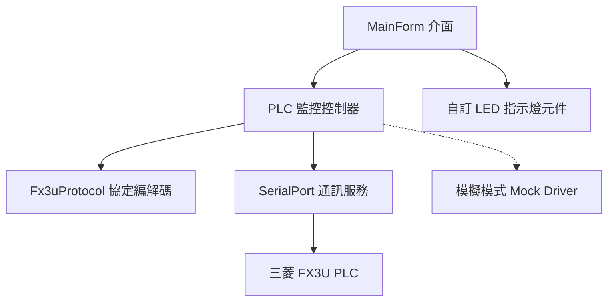

# 三菱 PLC (FX3U) 序列埠監控與控制 C# Windows Forms 程式開發計劃

本專案旨在為使用者開發一套專為三菱 (Mitsubishi) FX3U PLC 設計的 C# Windows Forms 監控與控制軟體，支援 Visual Studio 2026 / 2022 與現代 .NET (8.0-windows)。透過序列埠 (RS-422/RS-232 程式通訊埠協定)，實現對 X0~X17 接點讀取監控、Y0~Y17 輸出狀態監控，以及對 Y0~Y17 進行強制 ON/OFF 控制。

---

## 系統需求與通訊規格確認

1. **開發環境與框架**：
   - IDE: Visual Studio 2026 / Visual Studio 2022
   - 語言: C# 12 / 13
   - 目標架構: Windows Forms (.NET 8.0-windows，同時相容 VS 2026 / .NET 10 SDK)
2. **通訊介面規格**：
   - 介面: Serial Port (COM)
   - 波特率 (Baud Rate): 9600
   - 資料位元 (Data Bits): 7
   - 同位檢查 (Parity): Even (偶同位)
   - 停止位元 (Stop Bits): 1
   - 流控 (Handshake): None
3. **通訊協定細節 (FX Programming Port Protocol)**：
   - **讀取 Y0~Y17 (CMD: 0x30, 位址 0x00A0, 長度 2 位元組)**:
     - 傳送: `02 30 30 30 41 30 30 32 03 36 36`
     - PLC 回傳: `02 [B0] [B1] [B2] [B3] 03 [SUM1] [SUM2]` (共 8 位元組)
     - 解析規則 (ASCII Hex 轉 4-bit 狀態):
       - `B0` (例 `0x35` -> `'5'` -> `0b0101`): 對應 **Y4 ~ Y7** (bit0: Y4, bit1: Y5, bit2: Y6, bit3: Y7)
       - `B1` (例 `0x35` -> `'5'` -> `0b0101`): 對應 **Y0 ~ Y3** (bit0: Y0, bit1: Y1, bit2: Y2, bit3: Y3)
       - `B2` (例 `0x38` -> `'8'` -> `0b1000`): 對應 **Y14 ~ Y17** (bit0: Y14, bit1: Y15, bit2: Y16, bit3: Y17)
       - `B3` (例 `0x34` -> `'4'` -> `0b0100`): 對應 **Y10 ~ Y13** (bit0: Y10, bit1: Y11, bit2: Y12, bit3: Y13)
   - **讀取 X0~X17 (CMD: 0x30, 位址 0x0080, 長度 2 位元組)**:
     - 傳送: `02 30 30 30 38 30 30 32 03 35 44`
     - PLC 回傳: `02 [B0] [B1] [B2] [B3] 03 [SUM1] [SUM2]`
     - 解析規則:
       - `B0`: 對應 **X4 ~ X7**
       - `B1`: 對應 **X0 ~ X3**
       - `B2`: 對應 **X14 ~ X17**
       - `B3`: 對應 **X10 ~ X13**
   - **強制 Y0~Y17 輸出 (ON / OFF)**:
     - 採用使用者提供之精確 Byte 陣列 (CMD: `0x37` 為 Force ON，`0x38` 為 Force OFF，搭配 ETX 與校驗碼)。
     - 支援所有點位: Y0, Y1, Y2, Y3, Y4, Y5, Y6, Y7, Y10, Y11, Y12, Y13, Y14, Y15, Y16, Y17。

---

## 軟體架構設計



### 1. 核心模組規劃
- **`Fx3uProtocol.cs`**：
  - 定義讀取命令常數 (`READ_Y_CMD`, `READ_X_CMD`)。
  - 封裝完整 16 組 Y 點位的 Force ON / Force OFF Byte 陣列對照表。
  - 解析 4 位元組 ASCII 回傳資料為 `bool[16]` 陣列 (X0~X7, X10~X17 與 Y0~Y7, Y10~Y17)。
  - 附帶校驗和 (Checksum) 計算工具方法，方便未來擴充。
- **`PlcService.cs`**：
  - 封裝 `System.IO.Ports.SerialPort`。
  - 具備背景輪詢工作緒 (`Task.Run` + `PeriodicTimer` / `CancellationTokenSource`)，確保介面完全不卡頓。
  - 自動交替查詢 X 與 Y (例如：輪詢週期 100ms~200ms，依序發送讀取 Y、讀取 X)。
  - 支援執行強制 Y 寫入指令 (優先排程，立即送出並等待回應)。
  - 提供通訊封包日誌回呼事件 (`OnTxRxLog`)，方便即時檢視十六進位原始碼。
  - 內建「模擬模式 (Simulation Mode)」，若使用者目前電腦未接上實體 PLC，亦可開啟模擬測試介面操作。
- **`LedIndicator.cs` (自訂控制項)**：
  - 精美工控 LED 燈號元件，支援平滑圓角、漸層光暈 (Glow Effect)、狀態文字與顏色設定 (X 點亮綠燈、Y 點亮琥珀橘/藍燈)。
- **`MainForm.cs` (主畫面)**：
  - **連線設定區**：COM Port 下拉選單 (自動抓取、手動重新整理)、連線/中斷連線按鈕、通訊參數提示 (9600, 7, Even, 1)、連線狀態指示燈。
  - **X 輸入點監控區 (X0~X17)**：16 顆 LED 排列整齊，直觀呈現輸入點 ON/OFF 即時動態。
  - **Y 輸出點監控與強制控制區 (Y0~Y17)**：
    - 每個點位包含：狀態 LED、標籤、以及「強制 ON / OFF」開關或切換按鈕。
    - 點擊按鈕立即發送命令並於監控中同步確認回傳狀態。
  - **通訊封包日誌區 (TX/RX Log)**：
    - 顯示送出 (TX) 與接收 (RX) 的 Hex 字串、時間戳記與解析結果。
    - 附帶「自動捲動」與「清除記錄」功能。
  - **狀態列 (Status Strip)**：
    - 顯示目前連線狀態、輪詢次數、通訊延遲時間 (ms)、錯誤次數。

---

## 預計產出檔案結構

```
FX3U/
├── Fx3uMonitor.sln                 # Visual Studio 方案檔
└── Fx3uMonitor/
    ├── Fx3uMonitor.csproj          # 專案檔 (net8.0-windows)
    ├── Program.cs                  # 程式進入點
    ├── Controls/
    │   └── LedIndicator.cs         # 專用工控 LED 視覺控制項
    ├── Services/
    │   ├── Fx3uProtocol.cs         # FX3U 協定編解碼與點位映射
    │   └── PlcService.cs           # 序列埠連線管理與背景輪詢引擎
    └── Forms/
        ├── MainForm.cs             # 主視窗程式邏輯
        └── MainForm.Designer.cs    # 介面配置與佈局
```

---

## 驗證計劃

### 1. 編譯與建置驗證
- 使用 `dotnet build` 確保專案無警告且建置成功 (支援 .NET 8 / 10 與 Visual Studio 2026/2022)。
- 驗證各通訊命令 Byte 陣列與使用者提供之規範完全一致。

### 2. 協定解析單元測試 / 模擬驗證
- 驗證輸入範例：
  - 輸入 `02 35 35 38 34 03 43 33` -> 驗證 Y4=ON, Y6=ON, Y0=ON, Y2=ON, Y17=ON, Y12=ON，其餘為 OFF。
- 驗證強制控制：
  - 點擊 Y0 ON 發送 `02 37 30 30 30 35 03 46 46`。
  - 點擊 Y17 OFF 發送 `02 38 30 46 30 35 03 31 36`。

### 3. 使用者實機測試引導
- 程式編譯完成後，使用者可直接以 Visual Studio 2026 開啟 `Fx3uMonitor.sln`，或直接執行發佈的執行檔。
- 接上 USB-to-RS422 轉換線至 FX3U 程式口，選擇正確的 COM Port，按下「連線」即可開始實體監控與控制。

---

## 待確認項目 (Open Questions)

> [!NOTE]
> 1. 強制控制 Y 點時，當使用者點擊按鈕，您偏好**「切換開關 (Toggle)」**模式（點一次 ON、再點一次 OFF），還是**「獨立按鈕 (ON / OFF 分開各一顆)」**？（本計劃預設設計為直觀的「切換按鈕」搭配明確的「ON」「OFF」選單，亦可同時提供兩者）。
> 2. 是否需要儲存使用者上次選擇的 COM Port 設定？（預設會自動記憶在使用者設定檔中）。
